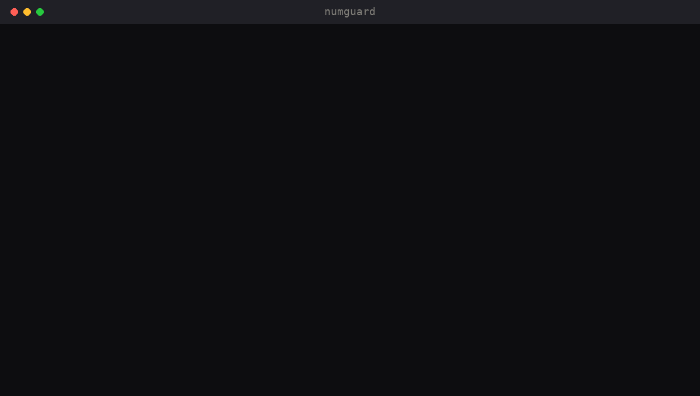

# numguard

**Your agent can't state a number it didn't compute.** numguard checks every number in an agent's answer against the tool outputs of the same session and flags the ones no tool produced. On a reproducible synthetic benchmark it caught **91.6%** of fabricated numbers (916/1000) with **0** false flags on 200 correct answers.

[](LICENSE)
[](#install)
[](#benchmark)




## Install

```bash
# Skill (any agent that reads SKILL.md)
npx skills add isaacbitran/numguard

# MCP server (Claude Code)
claude mcp add numguard -- npx -y github:isaacbitran/numguard

# Claude Code Stop hook (blocks a final answer with unvouched numbers) — see "Hook" below
npm i -g github:isaacbitran/numguard
```

<details>
<summary>Codex and Cursor (MCP)</summary>

`~/.codex/config.toml`:
```toml
[mcp_servers.numguard]
command = "npx"
args = ["-y", "github:isaacbitran/numguard"]
```

`.cursor/mcp.json`:
```json
{ "mcpServers": { "numguard": { "command": "npx", "args": ["-y", "github:isaacbitran/numguard"] } } }
```
</details>

## 20-second quickstart

```bash
$ cat result.csv
plan,customers,churned,churn_rate
starter,1840,212,0.1152
enterprise,58,2,0.0345

$ echo "Starter churn is 11.5%. Enterprise retained 81% of revenue." > answer.txt
$ npx -y github:isaacbitran/numguard check answer.txt --source result.csv
numguard: 1 number(s) do not appear in any tool output from this session:
  ✗ 81%   in "…n is 11.5%. Enterprise retained 81% of revenue."
Recompute each with a tool (query, script, API call) and use the result, cite the output it came from, or remove it.
```

`11.5%` passes (it is `0.1152` as a percent, rounded). `81%` does not: no query returned it. Exit code 1 when anything is flagged.

As a library:

```js
import { check } from 'numguard';
const r = check(answer, [sqlResult, apiJson], { question: userMessage });
// r.ok, r.unvouched: [{ value, raw, context }], r.vouched, r.ignored
```

## Why

Agents that query data write fluent summaries, and some of the numbers in those summaries were never returned by any query: an "81%" that is plausible, specific, and made up. Asking the model to "be careful" does not fix this. A deterministic check does: if a number in the answer cannot be traced to a tool output from this session, the agent has to recompute it with a tool, correct it, or drop it.

## How it works

1. **Extract** every number from the answer, with its sign, currency, thousands separators, decimals, and unit (`%`, `k`, `M`, `B`, `million`, …).
2. **Ignore** tokens that are not claims about data. Each rule has a name and can be turned off: `years`, `dates`, `times`, `ordinals`, `listMarkers`, `versions`, `labels` (Q3, step 4, #42), `code` (fenced blocks), `urls`, `smallCounts` (plain integers 0–3, configurable with `smallMax`), and `question` (numbers the user gave). Add your own with `extraIgnore: [/order ID \d+/]`.
3. **Vouch** each remaining number: it passes if some value in the sources, possibly ×100 (fraction → percent) or scaled by its k/M/B suffix, rounds to it at the precision it was written. `18.67` vouches `18.7` and `19` but not `18.6`; `1,234,567` vouches `$1.23M`; `0.593` vouches `59.3%` and `59%`.
4. **Report** the unvouched numbers with their surrounding text.

No model calls, no network, one dependency (the MCP SDK, only loaded for the MCP server). The benchmark checks 1,600 answers in about 45 ms on a laptop.

## Surfaces

| Surface | Use |
|---|---|
| Library | `check(answer, sources, opts)` |
| CLI | `numguard check answer.txt --source a.csv --source b.json [--question "..."] [--small-max N] [--no-ignore] [--json]` |
| MCP server | `numguard_check` (answer + source texts), `numguard_record` (store a tool output under a session id), `numguard_reset` |
| Claude Code hook | `numguard hook` on the `Stop` event: reads the session transcript, uses every tool result as a source, blocks the stop if the final message has unvouched numbers |
| Skill | `skills/numguard/SKILL.md` tells the agent to check before finalizing any answer with numbers |

### Hook

Add to `.claude/settings.json` (project) or `~/.claude/settings.json` (all projects):

```json
{
  "hooks": {
    "Stop": [
      { "hooks": [ { "type": "command", "command": "numguard hook", "timeout": 30 } ] }
    ]
  }
}
```

Without a global install, use `"command": "npx -y github:isaacbitran/numguard hook"` (slower: npx resolves the package on every stop). Add `--warn` to print the report without blocking. The hook reads `last_assistant_message` (or the transcript's final assistant text), treats every `tool_result` in the transcript as a source and every user message as the question, and returns `{"decision":"block","reason":...}` so Claude fixes the numbers before stopping. It never blocks twice in a row (`stop_hook_active`), so it cannot loop.

## Benchmark

`npm run bench` (no API calls, seed 42). 200 generated cases, each a sales table of 6–10 cities (units, revenue, average price, store count, growth, return rate) plus a second query result with the total. For each case: one correct answer that restates 5 values in mixed formats (`48.2k`, `$1.23M`, `$2.8 million`, `$74.29`, `-10.8%`, `12%`) with years, dates, ordinals and list markers as noise, and one corrupted answer per corruption type with exactly one wrong number.

| Set | What the answer contains | Result |
|---|---|---|
| Correct answers | only table values, restated with rounding, %, k/M, $ | 0.0% falsely flagged (0/200 answers; 0/1200 numbers) |
| off_by_digit | one digit changed | 88.5% caught (177/200) |
| swapped_digits | two adjacent digits swapped | 97.0% caught (194/200) |
| invented | an extra sentence with a made-up number | 100.0% caught (200/200) |
| wrong_percent | a percent shifted by 1–9 points | 80.0% caught (160/200) |
| wrong_rounding | last shown digit off by one | 92.5% caught (185/200) |
| **All fabricated** | 5 corruption types above | **91.6% caught (916/1000)** |
| wrong_row (limit) | a real value from a different row | 0.0% caught (0/200) |
| derived_sum (by design) | a correct sum the agent did in its head | 100.0% flagged (200/200) |

Seeds 1–5 give 90.0–92.8% caught with 0 false flags. Every miss is a collision: the wrong number happens to equal (after rounding) another real value in the session's outputs, which is most common for low-precision numbers such as `9%`.

What this does and does not measure:
- The correct answers are template-generated and only restate table values, so 0 false flags is a lower bound. Real agent prose will produce some false flags, mostly numbers the agent derived without a tool (see `derived_sum`) and identifiers the ignore rules do not know about.
- The corruptions are synthetic. Real fabrications may be closer to real values than these.

## Limits

- **A real number in the wrong place passes.** If the answer gives row B's value for row A, or a revenue figure as a cost, the number does appear in the outputs. numguard checks that a number was computed, not that it is attached to the right thing.
- **Coincidences pass.** Low-precision numbers (`9%`, `12`) can match an unrelated value. Larger tables mean more coincidences.
- **Derived numbers are flagged by design.** A sum, difference or ratio the agent did in its head is unvouched until a tool computes it.
- **Laundering is possible.** An agent can make a number pass by echoing it through a tool. The skill tells it not to; the check cannot tell.
- **Sign is not checked.** `-5%` and `5%` are vouched by the same value (answers often say "fell 5%" for `-0.05`).
- **Formats:** English number formatting only (`1,234.5`); European `1.234,5` is not parsed. Words ("twelve") are not checked.
- **Ignore rules are heuristics.** `10/20` is treated as a date; a bare `2025` as a year. Turn rules off with `ignore` or tighten them with `extraIgnore`.

## Origin

Extracted from the harness behind Edel AI, an AI analyst a college football staff uses every week.

## License

MIT © Isaac Bitran
